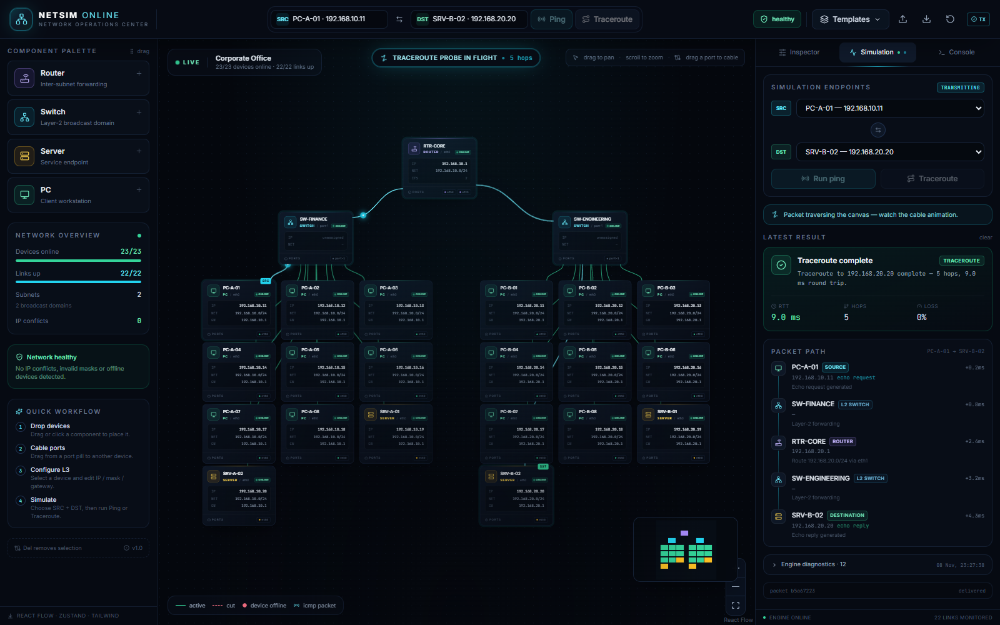
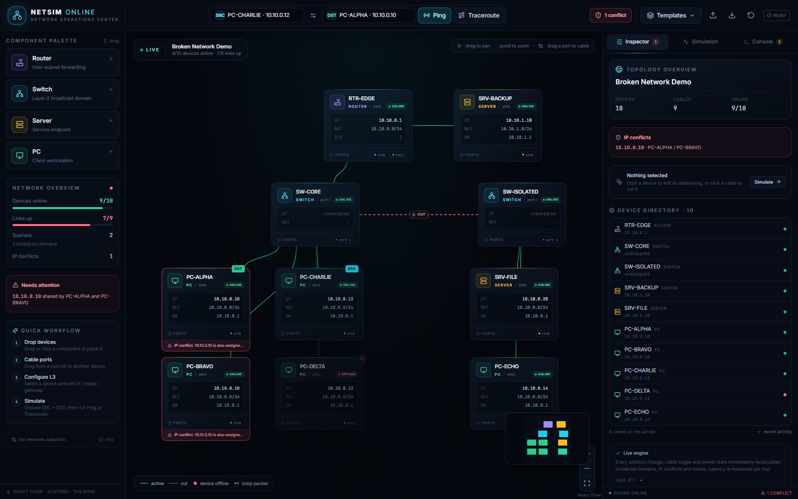

# NetSim Online

A portfolio-ready, dark-mode **Network Operations Center (NOC) simulator** built with React, TypeScript, Tailwind CSS and React Flow. Design a topology, configure real IPv4 addressing, break links and watch ping / traceroute traffic travel across the canvas with hop-by-hop results.



> **Try it in one click:** the app boots into the *Corporate Office* scenario. Choose a source and destination in the top bar, then press **Ping** or **Traceroute**.

---

## Highlights

- **Interactive topology builder** — drag routers, switches, servers and PCs from the palette (or click to quick-add), reposition them, and cable interface ports together.
- **Real IPv4 behaviour** — interface addresses, subnet masks, default gateways and MAC addresses validated live; network and broadcast addresses derived from CIDR.
- **Broadcast-domain-aware conflict detection** — duplicate addresses are flagged only when they sit in the same L2 domain, with per-device warnings and a global health chip.
- **Routing engine** — routers expose connected routes plus user-defined static routes; forwarding uses longest-prefix match, and hosts must have a valid gateway for cross-subnet traffic.
- **Ping & traceroute** — hop-by-hop packet path, deterministic per-hop latency, request/reply animation, clear failure reasons (offline device, IP conflict, cut cable, missing gateway or route, no L2 path).
- **Fault injection** — power devices off/on, cut and restore cables, or delete them. Every change recalculates health, domains and routes immediately.
- **Recruiter scenarios** — three prebuilt topologies, including an intentionally broken network that demonstrates conflict diagnosis.
- **JSON persistence** — export the current topology and import it back with schema validation and actionable error toasts.
- **NOC aesthetic** — live status panels, minimap, animated packet dots, event console, toasts and a responsive top bar.



---

## Quick start

```bash
npm install
npm run dev
```

Open the URL printed by Vite (usually `http://localhost:5173`).

```bash
npm run build     # strict TypeScript build + production bundle
npm run preview   # serve the production build
npm run lint      # type-check only (tsc -b --noEmit)
```

### Requirements

- Node.js 18+
- A modern browser (Chromium, Firefox or Safari)

---

## How to use it

1. **Place devices** — drag components from the left palette onto the canvas, or click a palette card to add one at the viewport centre.
2. **Cable them** — drag from a port pill (`eth0`, `port-1`, …) on one device to a port on another. A cable can be drawn in either direction.
3. **Configure L3** — click a device to open the inspector. Edit IPv4, mask, gateway and MAC. Routers also expose interfaces and a routing table.
4. **Simulate** — pick `SRC` and `DST` in the top bar (or the Simulation tab), then run **Ping** or **Traceroute**.
5. **Inject faults** — toggle device power in the inspector, or click a cable and choose **Cut cable**. The canvas immediately turns cut links dashed red and recalculates reachability.
6. **Persist** — use the import/export icons in the top bar to save or reload a scenario as JSON.

### Keyboard & canvas

| Action | Control |
| --- | --- |
| Pan | Drag empty canvas |
| Zoom | Mouse wheel / trackpad |
| Fit topology | Fit-view control (bottom right) or load a template |
| Remove selection | `Delete` or `Backspace` |
| Deselect | Click empty canvas |

> The layout is **desktop-first**, as is typical for NOC tooling. Below `xl` the simulation controls move to a second top-bar row; the palette is hidden below `md` and the right panel below `lg`.

---

## Templates

| Template | Devices | What it demonstrates |
| --- | --- | --- |
| **Corporate Office** | 23 devices · 22 links | Two /24 subnets, two switches, one router, 20 hosts. Suggested flow: `PC-A-01 → SRV-B-02`. |
| **Broken Network Demo** | 10 devices · 9 links | Duplicate `10.10.0.10`, one powered-off host and a cut uplink. Suggested flow intentionally fails with a conflict diagnosis. |
| **Two-Site WAN** | 10 devices · 9 links | Two routers connected by a /30 transit link with static routes in both directions. Suggested flow: `PC-HQ-01 → SRV-BRANCH`. |

Use the **Templates** menu to load one, or start from a blank workspace.

---

## How the engine works

The simulation is fully client-side and deterministic. Pure functions in `src/engine/` are composed by the Zustand store; the UI only renders their output.

### Broadcast domains & conflicts

- Every interface endpoint is a union-find node.
- Each **switch** merges all endpoints attached to it into one L2 broadcast domain.
- **Disabled (cut) cables are excluded** from domain computation, so isolating a switch really does split the network.
- Two interfaces with the same IPv4 address conflict only when they resolve to the same domain and subnet.

### Layer 2 (same subnet)

Traffic uses a graph search restricted to **switches** between the two hosts. Routers are not used, mirroring a flat broadcast domain. If no switch path exists, the result is `Destination Host Unreachable`.

### Layer 3 (cross subnet)

1. The source host must have a **default gateway** that belongs to its own subnet.
2. The gateway must sit on a router interface reachable through the topology.
3. Each router performs a **longest-prefix match** over its connected and static routes.
4. The selected next hop must be reachable on the egress interface, and the path continues until the destination subnet is reached.
5. Failures return specific diagnostics: missing gateway, wrong gateway, no matching route, unreachable next hop, or no active routed path.

### Latency & animation

- Per-hop latency is derived from a seeded jitter function, so repeated runs are stable and reproducible.
- Each result includes a device path and a parallel cable path. The store schedules `animateMotion` passes for every cable: a cyan request leg and, for successful pings, an emerald reply leg in reverse order.
- The edge component resolves the true geometric direction of each traversal, so packets follow the request's real path even when a template stores a cable as `switch → host` but the packet travels `host → switch`.

### Health model

Health is recomputed from the current devices and cables:

- online/offline device counts,
- up/cut link counts,
- broadcast domains and subnets,
- IP conflicts,
- per-device configuration alerts (invalid addresses, gateway issues, duplicates).

The result drives the top-bar health chip, palette overview, node badges, cable styling and the inspector warnings.

---

## Architecture

```text
src/
├─ components/
│  ├─ canvas/NetworkCanvas.tsx     React Flow wiring, drop target, overlays
│  ├─ edges/NetworkEdge.tsx        Floating edges, cut styling, packet animation
│  ├─ nodes/NetworkNode.tsx        Device cards, ports, conflict/offline badges
│  ├─ layout/                      TopBar, Palette, Inspector, Simulation,
│  │                               Console, Templates, RightPanel, Toast
│  └─ deviceTheme.ts               Icon/colour system per device type
├─ data/
│  ├─ deviceFactory.ts             Defaults + automatic address assignment
│  ├─ templates.ts                 Recruiter topologies
│  └─ persistence.ts               Export download, import validation
├─ engine/
│  ├─ ip.ts                        IPv4, CIDR, mask and validation utilities
│  ├─ topology.ts                  Adjacency, domains, conflicts, health
│  ├─ routing.ts                   Connected/static tables, longest-prefix match
│  └─ simulation.ts                Ping / traceroute pathfinding + diagnostics
├─ hooks/useNetworkHealth.ts       Memoised engine selectors for React
├─ store/useNetworkStore.ts        Zustand state, actions, animation schedule
├─ types/network.ts                Strict domain model
└─ utils/format.ts                 IDs, time, latency and class helpers
```

### Core types

- `Device` — `id`, `name`, `type` (`router | switch | server | pc`), power state, position, routing table and one or more `NetworkInterface`s.
- `NetworkInterface` — `id`, `name`, IPv4/mask/gateway/MAC.
- `Connection` — cable with source/target device and interface IDs, media type and enabled state.
- `SimulationResult` — protocol, success, device and cable paths, hops, RTT, diagnostics and packet metadata.

TypeScript runs in **strict mode** and the codebase avoids `any`; engine inputs/outputs are typed, and the React Flow node/edge generics are bound to the domain types.

---

## Persistence format

Exported files are versioned JSON:

```json
{
  "format": "netsim-online",
  "version": 1,
  "exportedAt": "2026-01-01T12:00:00.000Z",
  "name": "Corporate Office",
  "devices": [],
  "connections": []
}
```

Imports are validated before touching the canvas. Missing arrays, invalid devices/connections or an unsupported format produce a toast and a console log entry instead of corrupting the workspace.

---

## Quality checks performed

The app was exercised end-to-end in headless Chromium (Playwright):

- Corporate Office: 23 devices / 22 cables; ping and traceroute succeed with 5 hops.
- Two-Site WAN: routed ping and traceroute succeed across the /30 transit link (6 hops); static routes are visible and editable.
- Broken Network: no node overlaps, 9/10 devices online, 7/9 links up, one conflict, ping fails with a conflict-specific message.
- Device power-off produces an immediate offline state and a failed simulation; restoring power restores connectivity.
- Editing an address to duplicate another host raises a conflict chip and per-node warnings instantly.
- Cable cut/restore changes reachability; cable draw and delete work from the canvas.
- Palette quick-add and drag-and-drop both create devices; invalid JSON import shows an error toast.
- Responsive top bar tested from 390 px to 1600 px with no horizontal overflow or overlapping controls.
- No browser console errors or uncaught page errors during the flows above.
- Unit coverage: 78 Vitest tests across IPv4/CIDR validation, broadcast domains, IP conflict detection, routing-table lookups (including unusable static-route diagnostics), and ping/traceroute success and failure paths.

---

## Portfolio notes

This project focuses on the parts that make a network simulator believable rather than decorative:

- A **pure engine** separated from the UI, making routing and failure logic easy to reason about and extend.
- **Domain-correct fault behaviour**, such as conflicts only within one broadcast domain and cut cables splitting L2 segments.
- **Deterministic latency** and reproducible diagnostics, useful for demos and regression checks.
- A **NOC-style visual language**: dense status information, restrained colour, live cable states and animated packet flow without hiding the underlying topology.
- A **clean component structure** with custom hooks and typed React Flow nodes/edges.

## Possible next steps

- Undo/redo history for topology edits.
- ARP/DHCP simulation and a MAC address table per switch.
- VLANs, ACLs and NAT.
- Shareable URL snapshots and a guided tour mode.

---

Built with React 18, TypeScript, Vite, Tailwind CSS, React Flow (`@xyflow/react`), Zustand and Lucide icons.
